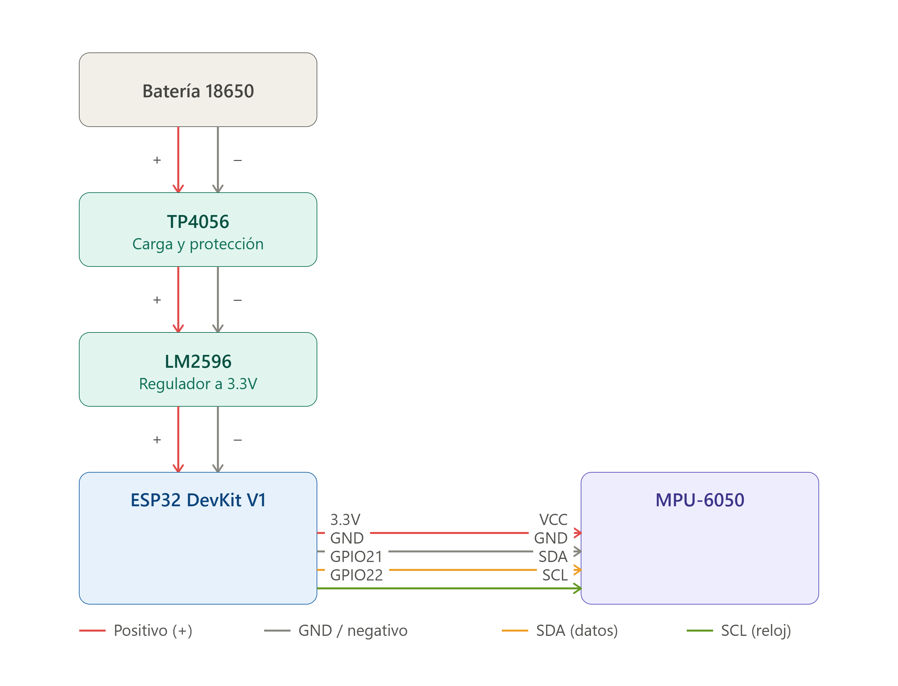
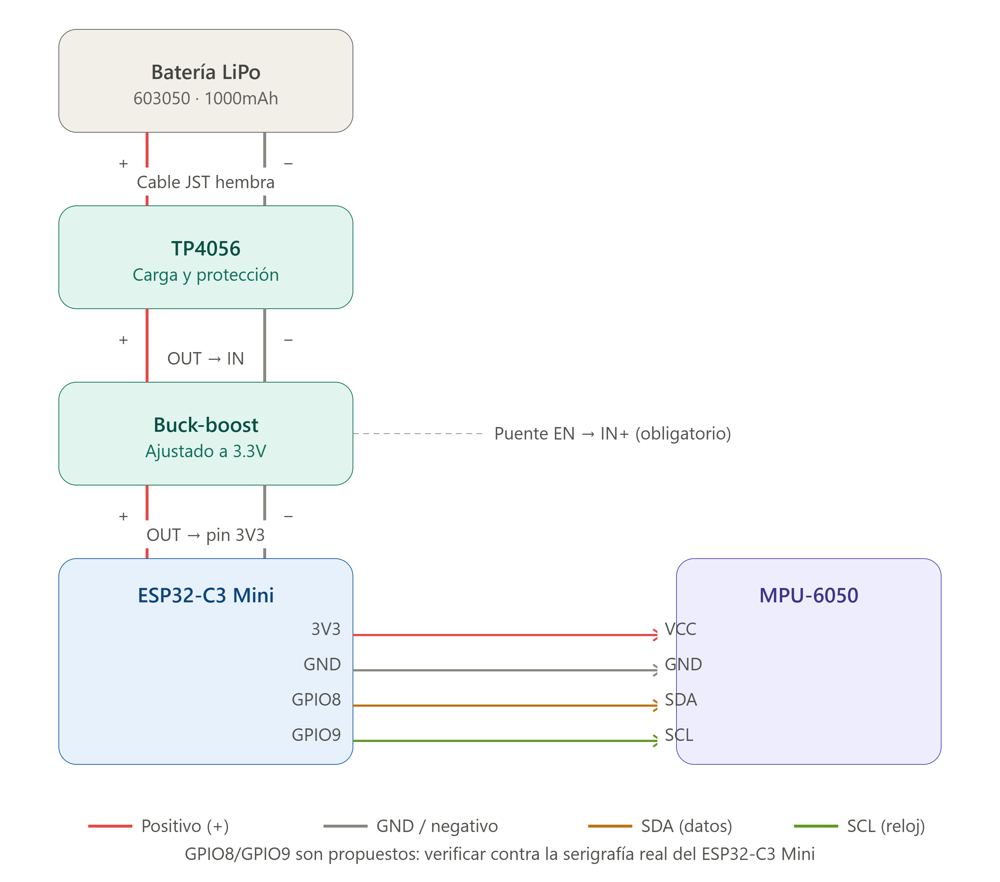

# HIT TRACKER

> Plataforma completa de entrenamiento de boxeo. Planes de ejercicio, sesiones con análisis en tiempo real y sensor ESP32 vía Bluetooth BLE.

---

## ¿Qué es?

HIT TRACKER es una app móvil Android para boxeadores que quieren entrenar con estructura y medir su rendimiento. Combina dos módulos:

**Módulo Entrenamiento** — Crea planes con calentamiento, trabajo de core y boxeo. Ejecuta el plan completo: el WorkoutPlayer te guía por los ejercicios físicos y, al terminar, arranca directamente la sesión de boxeo con los rounds y combos que hayas definido.

**Módulo Sesión** — Sesión de boxeo directa conectada al sensor ESP32. Registra cada golpe con su potencia y cadencia, ronda a ronda. Al terminar, tienes el historial completo con gráficos de progreso.

No requiere cámara, ni suscripción, ni cuenta. El sensor vale ~15€ y los datos son tuyos.

---

## Funcionalidades

### Entrenamiento completo

- Crea **planes de entrenamiento** con tres fases: calentamiento → core → boxeo
- Catálogo de ejercicios integrado con tabs por categoría (Calentamiento / Core / Boxing), adaptado del dataset público **[exercises-dataset](https://github.com/hasaneyldrm/exercises-dataset)** (MIT License)
- Busca e importa ejercicios adicionales desde **[wger](https://wger.de)** — base de datos pública de entrenamiento
- Añade ejercicios personalizados a tu catálogo
- Define **combos por ronda**: la notación aparece en pantalla durante la cuenta atrás antes de cada round
- El plan se ejecuta en secuencia: el WorkoutPlayer te guía por los ejercicios físicos y arranca el boxeo automáticamente al terminar

### Sesión de boxeo

- Detección de golpes en tiempo real via BLE (sensor ESP32) o firmware V3/V4 (detección en hardware)
- Configura rondas, descansos y número de rounds
- **Modo libre**: sin límite de tiempo, el usuario termina la ronda manualmente
- Métricas en directo: potencia máxima, HPM actual y promedio, gráfico de golpes
- Audio: campana distinta para inicio de ronda, fin de ronda y fin de sesión; cuenta atrás con beeps
- Resultados al terminar con gráfico de evolución por ronda
- Compartir sesión como imagen

### Dashboard y progreso

- Tu power: media de potencia de las últimas 5 sesiones con el perfil activo
- Gráfico de progreso: HPM y potencia de las últimas 8 sesiones
- Historial de sesiones (más reciente primero) con detalle completo (scatter por ronda, stats)

### Perfiles de calibración

- Múltiples perfiles (uno por tipo de saco, por persona, etc.)
- Wizard de calibración guiado: golpea ligero y fuerte, la app sugiere umbral y sensibilidad automáticamente
- Ajuste manual de threshold, sensitivity y rebound
- Eliminar un perfil pide confirmación y borra también sus sesiones guardadas

### Copia de seguridad en Google Drive

- Conecta una cuenta de Google desde Perfiles para respaldar sesiones y perfiles automáticamente
- Subida en silencio al terminar cada sesión o al editar un perfil; cola offline con reintento automático
- Al conectar en un móvil nuevo, descarga el historial existente en Drive
- Resolución de conflictos si los perfiles locales difieren de los de Drive (usar Drive, mantener locales, o combinar)
- Los datos se guardan en `drive.appdata`, una carpeta oculta accesible solo por la app

---

## Hardware



> ⚠️ **Hardware de prototipado**, no un producto terminado. En particular, la batería 18650 y su circuito de carga (TP4056 + LM2596) no llevan protección de sobrecarga/sobredescarga más allá de la que trae el módulo TP4056 — usa celdas con protección (18650 "protected") y supervisa la carga. Móntalo bajo tu responsabilidad.
>
> Precisamente por dar cabida a la 18650 y su circuito de carga, el tamaño final queda más abultado de lo deseable. Ya existe una versión miniaturizada con **ESP32-C3 Mini**, más compacta:
>
> 

**Posición del sensor**: punto de anclaje del saco (menor oscilación pendular).

| Tipo de saco | Posición |
|---|---|
| Saco colgado | Cerca del enganche superior |
| Saco de pie | Base inferior, periférico al mástil |

### Versiones de firmware

| Versión | Protocolo | LEDs | Batería |
|---|---|---|---|
| V2 | Stream continuo 16 bytes/10ms | — | — |
| V3 | Hit events 6 bytes/golpe; config BLE | — | — |
| **V4** | Hit events 6 bytes/golpe; config + batería BLE | 4 LEDs | ADC GPIO 34 |

El firmware V4 incluye 4 LEDs indicadores (encendido, BLE, golpe, reserva) y monitorización de la batería 18650 via divisor de voltaje.

Ver [`docs/GUIA-CONEXION-V1.md`](docs/GUIA-CONEXION-V1.md) para el esquema de conexión completo.

---

## Inicio Rápido

### 1. Firmware ESP32

```
Arduino IDE 2 → Board: ESP32 Dev Module → Upload Speed: 921600
```

Abre `FIRMWARE/HitTracker_V4/HitTracker_V4.ino`, sube al ESP32 y verifica en el Serial Monitor (115200 baud) que imprime lecturas.

### 2. App

```bash
npm install
npm run android
```

Requisito: Android 8+ con Bluetooth activado.

---

## Estructura del Proyecto

```
hit-tracker/
│
├─ shared/                    Tipos y lógica de negocio
│  ├─ types/index.ts          Training, Round, Impact, WorkoutPlan, Exercise...
│  ├─ services/               calibrationService · trainingService · exerciseService · migrationService
│  └─ data/                   exercises.json · routines.json (catálogo base)
│
├─ src/
│  ├─ core/
│  │  ├─ hooks/               useSensorData · useTraining · useWorkoutPlayer · useBleReading
│  │  ├─ stores/              deviceStore · profileStore · trainingStore · workoutPlanStore · customExerciseStore · driveStore
│  │  └─ services/            wgerService · exerciseService (re-exports)
│  ├─ services/               audio · ble · bleConnection · storage · googleAuth · driveSync
│  └─ components/
│     ├─ Dashboard/           Inicio: stats, progreso, historial
│     ├─ Session/             Sesión de boxeo directa
│     ├─ PlanRunner/          Módulo Entrenamiento: planes, player, catálogo, wger
│     ├─ Workout/             WorkoutPlayer (ejercicios físicos)
│     ├─ Devices/             Gestión de sensores BLE
│     ├─ Profiles/            Perfiles de calibración + wizard
│     └─ SessionDetail/       Detalle de sesión guardada
│
├─ FIRMWARE/
│  ├─ HitTracker_V3/          Hit events + config BLE + NVS
│  └─ HitTracker_V4/          V3 + 4 LEDs + monitorización batería
│
└─ docs/
   ├─ ARQUITECTURA.md         Flujo de datos, modelo, componentes
   ├─ DOCUMENTO_TECNICO.md    Tipos, hooks, stores, BLE, audio, build
   ├─ FUNCIONAL.md            Pantallas, flujos y conceptos para el usuario
   ├─ ROADMAP.md              Estado y próximos pasos
   ├─ COLORES.md              Paleta oficial
   ├─ GUIA-CONEXION-V1.md     Esquema de conexión hardware
   ├─ SENSOR-TECNICO-V*.md    Referencia técnica de cada versión de firmware
   └─ GOOGLE-DRIVE-SETUP.md   Credenciales OAuth2 para el backup en Google Drive
```

---

## Cómo funciona

### Detección de golpes

```
magnitude = √(ax² + ay² + az²)   [unidades raw, escala /16]

V2: la app detecta el pico cuando la magnitud baja tras superar el umbral dinámico
V3/V4: el firmware detecta el golpe y solo envía el evento (6 bytes por golpe)

intensity = clamp(0-100, (magnitude - base) / range × 100)
  donde base = threshold × 10, range = sensitivity × 10
```

### Fases de la sesión de boxeo

```
idle → preparing (10s) → round → resting → round → ... → finished
```

### Módulo Entrenamiento

```
WorkoutPlan
  └─ warmupExerciseIds → WorkoutPlayer (calentamiento)
  └─ coreExerciseIds   → WorkoutPlayer (core)
  └─ boxing            → Sesión de boxeo (rondas + combos)
```

### Catálogo de ejercicios

El catálogo combina tres fuentes:
1. **Base**: ejercicios incluidos en la app (`shared/data/exercises.json`)
2. **Custom**: ejercicios creados por el usuario
3. **wger**: ejercicios importados desde [wger.de](https://wger.de) (búsqueda por nombre, filtro por equipamiento body weight y mancuernas)

Los ejercicios importados de wger se guardan localmente y están disponibles sin conexión.

**Atribución**: los ejercicios de calentamiento y core del catálogo base (`id` con prefijo `gv-`) están adaptados —nombre, instrucciones y grupos musculares, traducidos al español— del dataset público [hasaneyldrm/exercises-dataset](https://github.com/hasaneyldrm/exercises-dataset), publicado bajo licencia MIT. Los GIFs de estos ejercicios son © [Gym Visual](https://gymvisual.com), con licencia adquirida para uso en la app, y no se distribuyen en el repositorio (`assets/exercises/*.gif` está en `.gitignore`) — quien clone el proyecto puede añadir sus propias imágenes licenciadas siguiendo la convención documentada en `assets/exercises/README.md` y ejecutando `npm run images:gen`.

---

## Stack Técnico

| Capa | Tecnología |
|---|---|
| Framework | Expo SDK 56 + React Native 0.85 + TypeScript 6 |
| Estado | Zustand 5 |
| Navegación | React Navigation 7 |
| BLE | react-native-ble-plx 3 |
| Audio | expo-audio 56 |
| Gráficos | react-native-svg 15 |
| Persistencia | expo-file-system 56 |
| Build | EAS Build / expo run:android |

---

## Troubleshooting

**ESP32 no aparece en el escaneo BLE**
- Verificar Bluetooth activado y permisos en Android
- Reiniciar el ESP32 (botón RST)
- Confirmar en Serial Monitor que el firmware está corriendo y anuncia `HT-PROT`

**Golpes erráticos o falsos positivos**
- Aumentar `threshold` en el perfil de calibración
- Usar el wizard de calibración para ajustar con golpes reales
- Verificar que el sensor está en el punto de anclaje del saco (no en la zona de impacto)

**wger no devuelve resultados**
- Verificar conexión a internet
- El debounce es de 2s — espera antes de ver resultados
- Intenta términos en inglés (la API tiene más cobertura en inglés)

**`@shared` no resuelve**
- Verificar que `metro.config.js` incluye `watchFolders` apuntando a `./shared`
- Reiniciar Metro: `expo start --clear`

---

## Documentación

| Documento | Contenido |
|---|---|
| [`docs/ARQUITECTURA.md`](docs/ARQUITECTURA.md) | Flujo de datos, modelo, árbol de componentes |
| [`docs/DOCUMENTO_TECNICO.md`](docs/DOCUMENTO_TECNICO.md) | Tipos, servicios, hooks, stores, BLE, audio |
| [`docs/FUNCIONAL.md`](docs/FUNCIONAL.md) | Pantallas, flujos y conceptos para el usuario |
| [`docs/ROADMAP.md`](docs/ROADMAP.md) | Estado actual y próximas features |
| [`docs/GUIA-CONEXION-V1.md`](docs/GUIA-CONEXION-V1.md) | Esquema de conexión hardware (batería + LEDs) |
| [`docs/SENSOR-TECNICO-V3.md`](docs/SENSOR-TECNICO-V3.md) | Firmware V3: hit events + config BLE |
| [`docs/SENSOR-TECNICO-V4.md`](docs/SENSOR-TECNICO-V4.md) | Firmware V4: LEDs + batería ADC |
| [`docs/GOOGLE-DRIVE-SETUP.md`](docs/GOOGLE-DRIVE-SETUP.md) | Credenciales OAuth2 para el backup en Google Drive |

---

## Distribución oficial

El repositorio oficial es **[github.com/adanoliva/hit-tracker](https://github.com/adanoliva/hit-tracker)**. Las distribuciones fuera de este repositorio no están verificadas por los autores.

## Licencia

GPL v3 — software libre; cualquier derivado debe distribuirse bajo la misma licencia.
